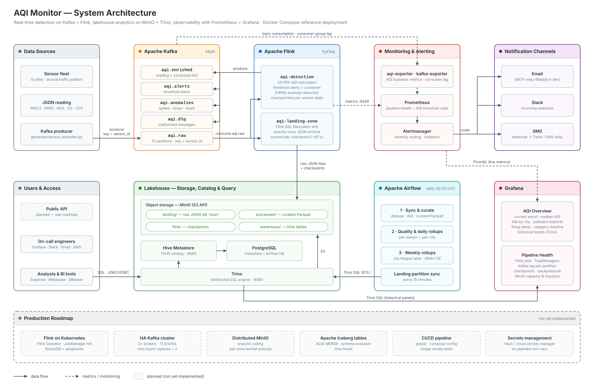

# AQI-Monitor

A streaming + batch lakehouse for Air Quality Index (AQI) data, built entirely on open-source components:

| Layer | Technology | What it does here |
|---|---|---|
| Ingestion | **Apache Kafka 3.8** (KRaft) | `aqi.raw` topic, 12 partitions keyed by `sensor_id` |
| Stream processing | **Apache Flink 1.18** (PyFlink) | per-reading AQI, threshold alerts, anomaly detection, landing-zone sink |
| Storage | **MinIO** (S3 API, `bitnamilegacy/minio` image) | `landing` (raw JSON) and `processed` (curated Parquet) zones |
| Catalog | **Hive Metastore 4.0** on Postgres | table and partition metadata for raw, curated and aggregated datasets |
| Query engine | **Trino 455** | ad-hoc SQL, ETL engine, BI / Grafana back end |
| Orchestration | **Apache Airflow 2.10** | daily curation, daily/weekly aggregation, partition sync, data-quality checks |
| Monitoring | **Prometheus + Alertmanager** | pipeline health (Kafka lag, Flink jobs, checkpoints) and AQI threshold alerts via email, Slack and SMS |
| Visualisation | **Grafana 11** | real-time AQI (Prometheus), historical trends (Trino), pipeline health |

---

## Architecture



*Editable source: `docs/architecture.py` — regenerate with `python docs/architecture.py`.*

### Data flow

1. **Ingestion.** Sensors (here, `generator/sensor_simulator.py`) publish JSON readings to `aqi.raw`. The message key is `sensor_id`, so each sensor's readings stay in order within one partition, and consumers can scale out to 12 parallel readers.
2. **Real-time processing** (`flink/jobs/aqi_detection_job.py`):
   * Validates each message and computes the US EPA AQI from PM2.5, PM10, NO2 and O3 (2024 breakpoints). CO2 gets its own indoor-air-quality level. Malformed messages go to `aqi.dlq`.
   * Keys the stream by sensor and keeps per-sensor state (checkpointed to MinIO):
     * **Threshold alerts.** AQI ≥151 is a warning, ≥201 is critical and ≥301 is an emergency. CO2 ≥1500, ≥2000 and ≥5000 ppm map to the same levels. An alert fires when the level rises, fires again after a cooldown (15 min, measured in event time), and sends RESOLVED when the reading recovers. Output goes to `aqi.alerts`.
     * **Anomalies.** Detects EWMA z-score spikes and drops (|z| ≥ 4 after a 20-reading warm-up), physically impossible values, and stuck sensors (30 identical readings in a row). Output goes to `aqi.anomalies`.
   * Every reading with its AQI attached is written to `aqi.enriched`.
3. **Landing zone** (`flink/jobs/landing_zone_job.py`). A Flink SQL filesystem sink writes every raw record to `s3a://landing/aqi/raw/dt=YYYY-MM-DD/hour=HH/` as JSON lines. Files are committed exactly once, on each checkpoint.
4. **Batch ETL** (`airflow/dags/aqi_daily_aggregation.py`). Runs daily at 00:30 UTC and executes these steps in Trino:
   1. Sync Hive partitions for the raw table.
   2. Wait for the day's raw data to arrive.
   3. Build `curated.readings`: de-duplicate, drop implausible values, compute AQI, write Parquet to `processed/`.
   4. Run data-quality checks: row counts, duplicates, null AQI, timestamp bounds.
   5. Build `analytics.daily_sensor_aqi` and `analytics.daily_city_aqi`, then `analytics.weekly_city_aqi`.
   6. Run `ANALYZE` to refresh table statistics.

   Every step overwrites its partition, so reruns and backfills are safe. A second DAG, `aqi_landing_partition_sync`, registers new raw partitions every 15 minutes for near-real-time ad-hoc SQL.
5. **Serving.** Trino queries all zones. Grafana reads live metrics from Prometheus and historical aggregates from Trino.
6. **Monitoring and alerting.** Prometheus scrapes Flink, kafka-exporter, aqi-exporter and MinIO. Rules in `monitoring/prometheus/rules/` cover pipeline health and AQI thresholds. Alertmanager routes each alert by category and severity to email, Slack and an SMS webhook.

### Streaming and batch use the same AQI logic

`aqi_common/aqi.py` is the single source of the EPA breakpoints. The Flink job imports it directly. The Airflow DAG uses it to generate the Trino `CASE` expressions, via Jinja macros in `airflow/dags/sql/*.sql`. A unit test runs the generated SQL in DuckDB and checks that it gives the same result as the Python code, so the real-time AQI and the historical AQI cannot drift apart.

---

## Documentation

| Document | What it covers |
|---|---|
| [`docs/SYSTEM_DESIGN.md`](docs/SYSTEM_DESIGN.md) | Interview-style system design: requirements, capacity estimation, deep dives, trade-offs, failure analysis, and a Q&A bank |
| `docs/AQI_System_Design_Document.docx` | Word version of the design doc — regenerate with `python docs/generate_system_design_docx.py` |
| [`docs/PROJECT_OVERVIEW.md`](docs/PROJECT_OVERVIEW.md) | Onboarding/stakeholder overview: purpose, tech stack, core functionality, outcomes |
| `docs/AQI_Project_Walkthrough.docx` | Word walkthrough — regenerate with `python docs/generate_walkthrough_docx.py` |
| [`docs/screenshots/architecture.svg`](docs/screenshots/architecture.svg) | Rendered architecture diagram — regenerate with `python docs/architecture.py` |

---

## Repository layout

```
aqi_common/              shared AQI + detection logic (Python 3.10+, no deps)
generator/               sensor simulator (Kafka producer) + Dockerfile
kafka/create-topics.sh   topic provisioning (partitions, retention)
flink/                   PyFlink image, jobs/ (detection, landing zone), submit-jobs.sh
hive/                    Hive Metastore image (Postgres JDBC + S3A) and hive-site.xml
trino/catalog/           Trino Hive connector (MinIO native S3)
trino/sql/ddl.sql        schemas + tables for raw, curated, aggregated datasets
airflow/                 Airflow image, DAGs and templated Trino SQL
exporter/                Kafka -> Prometheus bridge for AQI business metrics
monitoring/prometheus/   scrape config + alert rules (pipeline.yml, aqi.yml)
monitoring/alertmanager/ routing (email/Slack/SMS), message templates
grafana/                 provisioning (datasources, dashboards) + dashboard JSON
minio/, postgres/        bucket/lifecycle and database bootstrap
tests/                   unit tests (AQI math, detection, SQL templates)
```

---

## Setup

### Prerequisites

* Docker Desktop / Docker Engine 24+ with Compose v2.
* **At least 12 GB of RAM and 4 CPUs allocated to Docker.** The full stack runs about 20 containers.
* Around 10 GB of free disk space for images.
* Python 3.10+ if you want to run the tests or the simulator from your host.

### Start the stack

```bash
cp .env.example .env          # optional; every value has a local default
docker compose up -d --build
docker compose ps
```

The first build downloads the PyFlink, Hive JDBC/S3A and Airflow provider dependencies, which takes several minutes. Startup runs in this order, and the one-shot init containers exit when they finish:

`postgres, kafka, minio` → `kafka-init, minio-init` (topics, buckets, lifecycle rules) → `jobmanager, taskmanager` → `flink-job-submitter` (submits both Flink jobs) → `hive-metastore` → `trino` → `trino-init` (DDL) → `airflow-*`

The simulator starts streaming 40 sensors every 5 seconds as soon as the topics exist.

### Service URLs

| Service | URL | Credentials |
|---|---|---|
| Grafana | http://localhost:3000 | admin / admin |
| Flink UI | http://localhost:8081 | — |
| Trino UI | http://localhost:8080 | any user |
| Airflow | http://localhost:8088 | admin / admin |
| MinIO console | http://localhost:9001 | aqiadmin / aqiadmin-secret |
| Prometheus | http://localhost:9090 | — |
| Alertmanager | http://localhost:9093 | — |
| Mailpit (alert emails) | http://localhost:8025 | — |
| Kafka (from host) | localhost:9094 | — |
| AQI exporter metrics | http://localhost:8000/metrics | — |

All credentials shown are the built-in local-development defaults from `docker-compose.yml` /
`.env.example` — override them via `.env` before deploying anywhere shared.

### Check that it works

```bash
# Both Flink jobs RUNNING?
curl -s localhost:8081/jobs/overview | python -m json.tool

# Messages flowing?
docker compose exec kafka /opt/kafka/bin/kafka-console-consumer.sh \
  --bootstrap-server kafka:9092 --topic aqi.alerts --max-messages 5

# Raw files landing in MinIO (a file is committed on every checkpoint, about 60s)
docker compose run --rm --entrypoint sh minio-init -c \
  'mc alias set l http://minio:9000 $MINIO_ROOT_USER $MINIO_ROOT_PASSWORD >/dev/null; mc ls -r l/landing | tail'
```

The Flink UI shows both streaming jobs running:


---

## Usage examples

### Generate historical data for the batch layer

The daily DAG processes complete days. To get data for yesterday and earlier right away, backfill two days of history, with one reading per sensor every 5 minutes:

```bash
docker compose run --rm sensor-simulator \
  --bootstrap=kafka:9092 --sensors=40 --backfill-hours=48 --backfill-step=300 --exit-after-backfill
```

From the host (`pip install confluent-kafka`):

```bash
python generator/sensor_simulator.py --bootstrap localhost:9094 --sensors 100 --interval 2
python generator/sensor_simulator.py --dry-run --sensors 3 --max-messages 5     # inspect payloads
```

Example payload:

```json
{"schema_version":1,"sensor_id":"delhi-0000","city":"Delhi","latitude":28.50421,"longitude":77.31323,
 "pm25":64.17,"pm10":112.75,"no2":33.27,"o3":18.96,"co2":463.1,"firmware":"2.3.1",
 "event_time":"<YYYY-MM-DDTHH:MM:SS.sssZ>"}
```

### Run the Airflow ETL

```bash
# Process a specific day (the landing files must have been committed first)
docker compose exec airflow-scheduler airflow dags trigger aqi_daily_aggregation -c '{"target_date": "<YYYY-MM-DD>"}'

# Backfill a range
docker compose exec airflow-scheduler airflow dags backfill aqi_daily_aggregation -s <YYYY-MM-DD> -e <YYYY-MM-DD>
```

You can also use the Airflow UI: **Trigger DAG w/ config** and set `target_date`.


### Query with SQL (Trino)

```bash
docker compose exec trino trino --catalog hive
```

```sql
-- Near-real-time raw data (partitions registered every 15 min, or on demand):
CALL hive.system.sync_partition_metadata('landing', 'raw_readings', 'ADD');
SELECT city, count(*) AS readings, round(avg(pm25), 1) AS avg_pm25
FROM hive.landing.raw_readings
WHERE dt = CAST(current_date AS varchar)
GROUP BY city ORDER BY avg_pm25 DESC;

-- Curated readings: hourly AQI profile per city
SELECT city, hour(event_ts) AS hr, round(avg(aqi)) AS avg_aqi, max(aqi) AS max_aqi
FROM hive.curated.readings
WHERE dt = '<YYYY-MM-DD>'
GROUP BY 1, 2 ORDER BY 1, 2;

-- Which pollutant drives unhealthy air?
SELECT city, dominant_pollutant, count(*) AS n
FROM hive.curated.readings
WHERE aqi > 150 AND dt >= '<YYYY-MM-DD>'
GROUP BY 1, 2 ORDER BY n DESC;

-- Daily trend for BI tools
SELECT * FROM hive.analytics.v_city_daily_trend WHERE day >= current_date - INTERVAL '30' DAY ORDER BY day, city;

-- Weekly league table
SELECT week_start, city, round(avg_aqi, 1) AS avg_aqi, pct_unhealthy, aqi_category
FROM hive.analytics.weekly_city_aqi ORDER BY week_start DESC, avg_aqi DESC;
```

**BI integration.** Any tool with a Trino/Presto driver can connect to `localhost:8080`, catalog `hive`. That includes Superset, Metabase, Tableau, Power BI (ODBC), DBeaver and JDBC (`jdbc:trino://localhost:8080/hive`). DuckDB can also read the curated Parquet files directly from MinIO through its `httpfs` extension.

The Trino UI shows every query the cluster runs, including the ones issued by Grafana:


### Dashboards

Grafana provisions two dashboards, in the **AQI** folder:

* **AQI Overview** (`/d/aqi-overview`): current worst and median AQI, AQI by city, a pollutant explorer, the top sensors, streaming alert and anomaly rates, firing Alertmanager alerts, and an AQI category timeline. Historical panels (daily average AQI, % unhealthy readings, weekly summary, worst sensors yesterday) come from Trino. Use a 30-day or longer time range for the historical panels.
* **AQI Pipeline Health** (`/d/aqi-pipeline`): running Flink jobs and TaskManagers, Kafka consumer lag per group and partition, topic throughput, DLQ rate, Flink records/s, checkpoints, restarts and backpressure, the custom PyFlink counters, and MinIO capacity and requests.


*Screenshots captured from a live local stack — regenerate with `python docs/take_screenshots.py` (needs `pip install playwright` and a local Chrome).*

### Alerting

| Alert | Source | Default route |
|---|---|---|
| `AQIUnhealthy` / `AQIVeryUnhealthy` / `AQIHazardous` (median sensor per city >150 / >200 / >300) | aqi-exporter | Slack `#aqi-alerts` + email; critical and emergency also go to SMS |
| `SensorAQIVeryUnhealthy`, `CO2LevelHigh` | aqi-exporter | Slack + email |
| `SensorSilent`, `SensorAnomalyBurst` | aqi-exporter | field-ops email |
| `KafkaConsumerLagHigh/Growing`, `NoSensorDataIngested`, `DeadLetterQueueGrowing` | kafka-exporter | data-platform (critical alerts also go to Slack) |
| `FlinkJobsNotRunning`, `FlinkJobRestarting`, `FlinkCheckpointsFailing`, `FlinkNoTaskManagers` | Flink reporter | data-platform |
| `ScrapeTargetDown`, `MinioStorageNearlyFull` | Prometheus / MinIO | data-platform |

Inhibition rules suppress lower-severity AQI alerts for a city while a higher one is firing. They also suppress per-sensor "silent" alerts while ingestion as a whole is down.

**Configuring delivery channels.** Set these variables in `.env`, then run `docker compose up -d alertmanager`:

* **Email:** `SMTP_SMARTHOST`, `SMTP_FROM`, `SMTP_USERNAME`, `SMTP_PASSWORD`, `SMTP_REQUIRE_TLS=true`, `ALERT_EMAIL_TO`. By default, email goes to the bundled Mailpit inbox at http://localhost:8025.
* **Slack:** `SLACK_WEBHOOK_URL` (an Incoming Webhook URL), plus `SLACK_CHANNEL_AQI` and `SLACK_CHANNEL_PLATFORM`.
* **SMS:** `SMS_WEBHOOK_URL`. Alertmanager POSTs its standard webhook JSON to this URL. Point it at a small relay that calls Twilio, AWS SNS or a similar service. Template `aqi.sms.text` in `monitoring/alertmanager/templates/aqi.tmpl` gives a compact message body.

With the defaults, Slack and SMS payloads go to the `alert-sink` echo container. You can inspect them with `docker compose logs -f alert-sink`.

Separately from Prometheus alerting, the raw per-sensor streaming alerts on the Kafka topic `aqi.alerts` are available to any downstream consumer, such as a push-notification service or a public API.

### Development and tests

```bash
pip install -r requirements-dev.txt
python -m pytest tests -q
```

The tests cover the EPA AQI calculation, including truncation and boundary values; the anomaly and alert state machines; the Airflow SQL templates, which are rendered and then parsed as Trino SQL; and the check that SQL and Python compute the same AQI.

---

## Operations

| Task | Command |
|---|---|
| Scale Flink processing | `docker compose up -d --scale taskmanager=3`, then raise `DETECTION_PARALLELISM` (at most 12, the number of `aqi.raw` partitions) and resubmit |
| Resubmit Flink jobs (idempotent) | `docker compose run --rm flink-job-submitter` |
| Upgrade a job with state | `flink stop --savepointPath s3://flink/savepoints <jobId>`, then `flink run -s <savepoint> -d -py ...` (all operators have stable `uid`s) |
| Add partitions to `aqi.raw` | `kafka-topics.sh --alter --topic aqi.raw --partitions 24` (sources auto-discover partitions every 60s) |
| Reload Prometheus rules | `curl -X POST localhost:9090/-/reload` |
| Reprocess a day | trigger `aqi_daily_aggregation` with `target_date`; partitions are overwritten |
| Tear down (keep data) | `docker compose down` |
| Tear down and **delete all data** | `docker compose down -v` |

### Taking this to production

The Compose file is a single-node reference deployment. For production:

* **Kafka:** 3 or more brokers, a dedicated KRaft controller quorum, `KAFKA_REPLICATION_FACTOR=3`, `min.insync.replicas=2`, TLS/SASL, and a Schema Registry (Avro/Protobuf) for the sensor contract.
* **Flink:** run on Kubernetes with the Flink Kubernetes Operator (one `FlinkDeployment` per job), JobManager HA, the RocksDB state backend with incremental checkpoints, and periodic savepoints.
* **MinIO:** the compose file uses `bitnamilegacy/minio` (the frozen Bitnami build) because MinIO no longer publishes public images to Docker Hub/quay.io — substitute your own registry/build in production. Then run distributed mode with erasure coding (4 or more nodes), TLS, bucket policies per zone (writers can only reach the landing zone; Trino has read/write on the processed zone), and a scoped service account per component instead of the root user.
* **Hive Metastore / Trino:** an HA Postgres, several Trino workers, authentication (OAuth2/LDAP) and access control (file-based rules or Apache Ranger).
* **Airflow:** CeleryExecutor or KubernetesExecutor, secrets in a secrets backend (Vault, AWS SM), and `on_failure_callback` notifications.
* **Secrets:** keep them out of environment variables and use Docker/Kubernetes secrets instead. Alertmanager supports `api_url_file` and `auth_password_file`.
* **Table format:** consider Apache Iceberg (Trino `iceberg` connector with the same HMS) for ACID MERGE, schema evolution and time travel.

---

## Troubleshooting

* **Fewer than 2 Flink jobs running.** Check `docker compose logs flink-job-submitter jobmanager taskmanager`. The submitter retries on failure. You can re-run it at any time.
* **`hive.landing.raw_readings` returns no rows.** Files only become visible after a Flink checkpoint, about 60 seconds. Partitions must also be registered: run `CALL hive.system.sync_partition_metadata('landing','raw_readings','ADD')`.
* **Grafana Trino panels are empty.** The analytics tables only fill after the Airflow DAG has run. Backfill (see above), trigger the DAG, and widen the time range.
* **Containers get OOM-killed.** Give Docker more memory, or lower `FLINK_TM_MEMORY` and `TRINO_MEMORY_LIMIT`.
* **Scripts fail with `\r` errors on Windows.** The repo's `.gitattributes` forces LF endings. If you cloned the repo before that file existed, run `git add --renormalize .`.
