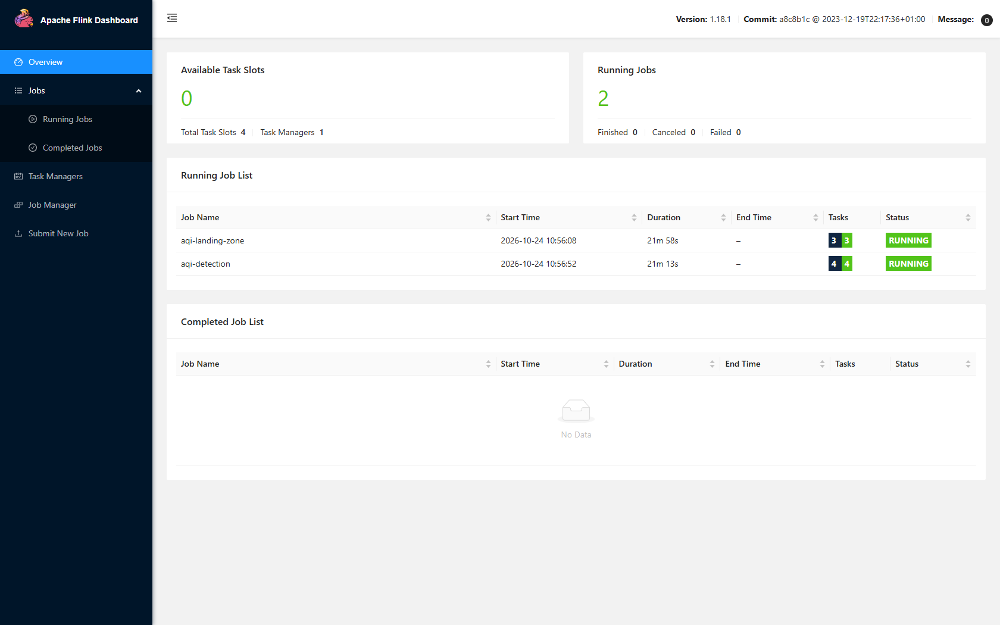
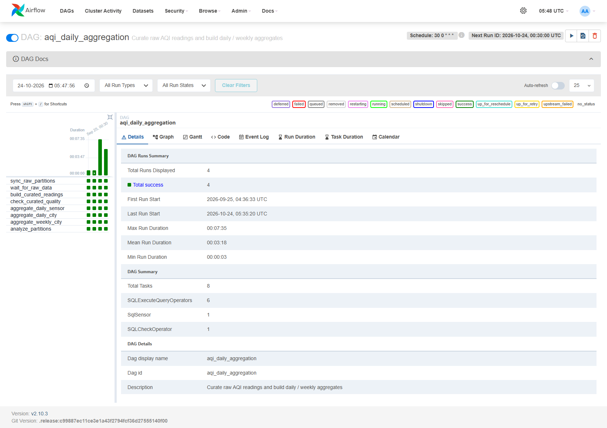
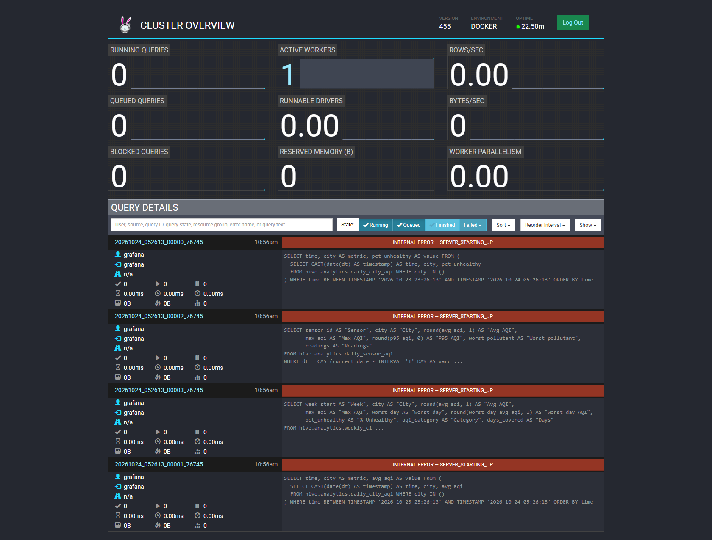
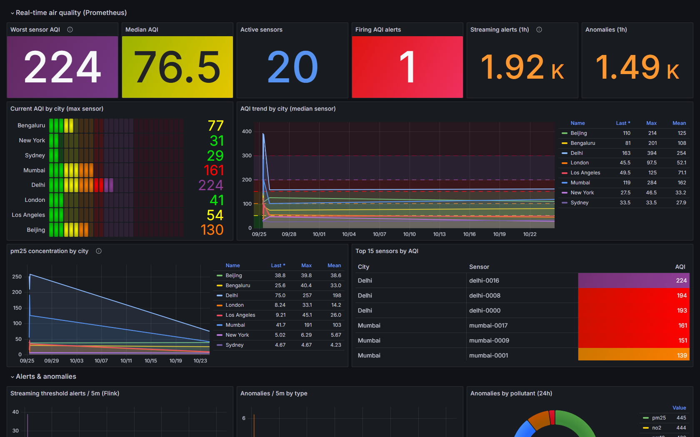
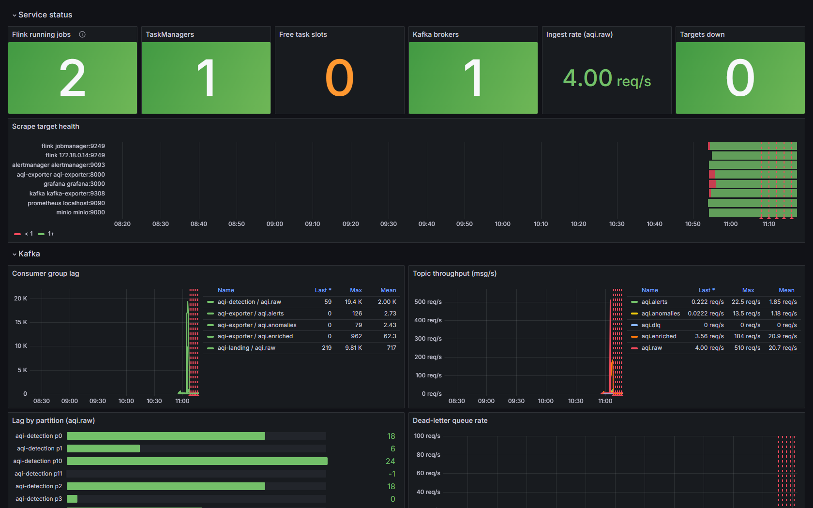

# AQI-Monitor

A streaming + batch lakehouse for Air Quality Index (AQI) data, built entirely on open-source components:

| Layer | Technology | What it does here |
|---|---|---|
| Ingestion | **Apache Kafka 3.8** (KRaft) | `aqi.raw` topic, 12 partitions keyed by `sensor_id` |
| Stream processing | **Apache Flink 1.18** (PyFlink) | per-reading AQI, threshold alerts, anomaly detection, landing-zone sink |
| Storage | **MinIO** (S3 API, `bitnamilegacy/minio` image) | `landing` (raw JSON) and `processed` (curated Parquet) zones |
| Catalog | **Hive Metastore 4.0** on Postgres | table and partition metadata for raw, curated and aggregated datasets |
| Query engine | **Trino 455** | ad-hoc SQL, ETL engine, BI / Grafana back end |
| Orchestration | **Apache Airflow 2.10** | daily curation, daily/weekly aggregation, partition sync, data-quality checks |
| Monitoring | **Prometheus + Alertmanager** | pipeline health (Kafka lag, Flink jobs, checkpoints) and AQI threshold alerts via email, Slack and SMS |
| Visualisation | **Grafana 11** | real-time AQI (Prometheus), historical trends (Trino), pipeline health |

---

## Architecture


### Data flow

1. **Ingestion.** Sensors publish JSON readings to `aqi.raw`. The message key is `sensor_id`, so each sensor's readings stay in order within one partition, and consumers can scale out to 12 parallel readers.
2. **Real-time processing** :
   * Validates each message and computes the US EPA AQI from PM2.5, PM10, NO2 and O3 (2024 breakpoints). CO2 gets its own indoor-air-quality level. Malformed messages go to `aqi.dlq`.
   * Keys the stream by sensor and keeps per-sensor state (checkpointed to MinIO):
     * **Threshold alerts.** AQI ≥151 is a warning, ≥201 is critical and ≥301 is an emergency. CO2 ≥1500, ≥2000 and ≥5000 ppm map to the same levels. An alert fires when the level rises, fires again after a cooldown (15 min, measured in event time), and sends RESOLVED when the reading recovers. Output goes to `aqi.alerts`.
     * **Anomalies.** Detects EWMA z-score spikes and drops (|z| ≥ 4 after a 20-reading warm-up), physically impossible values, and stuck sensors (30 identical readings in a row). Output goes to `aqi.anomalies`.
   * Every reading with its AQI attached is written to `aqi.enriched`.
3. **Landing zone** . A Flink SQL filesystem sink writes every raw record to `s3a://landing/aqi/raw/dt=YYYY-MM-DD/hour=HH/` as JSON lines. Files are committed exactly once, on each checkpoint.
4. **Batch ETL** . Runs daily at 00:30 UTC and executes these steps in Trino:
   1. Sync Hive partitions for the raw table.
   2. Wait for the day's raw data to arrive.
   3. Build `curated.readings`: de-duplicate, drop implausible values, compute AQI, write Parquet to `processed/`.
   4. Run data-quality checks: row counts, duplicates, null AQI, timestamp bounds.
   5. Build `analytics.daily_sensor_aqi` and `analytics.daily_city_aqi`, then `analytics.weekly_city_aqi`.
   6. Run `ANALYZE` to refresh table statistics.

   Every step overwrites its partition, so reruns and backfills are safe. A second DAG, `aqi_landing_partition_sync`, registers new raw partitions every 15 minutes for near-real-time ad-hoc SQL.
5. **Serving.** Trino queries all zones. Grafana reads live metrics from Prometheus and historical aggregates from Trino.
6. **Monitoring and alerting.** Prometheus scrapes Flink, kafka-exporter, aqi-exporter and MinIO. Rules in `monitoring/prometheus/rules/` cover pipeline health and AQI thresholds. Alertmanager routes each alert by category and severity to email, Slack and an SMS webhook.

### Streaming and batch use the same AQI logic

`aqi_common/aqi.py` is the single source of the EPA breakpoints. The Flink job imports it directly. The Airflow DAG uses it to generate the Trino `CASE` expressions, via Jinja macros in `airflow/dags/sql/*.sql`. A unit test runs the generated SQL in DuckDB and checks that it gives the same result as the Python code, so the real-time AQI and the historical AQI cannot drift apart.

## Repository layout

```
aqi_common/              shared AQI + detection logic (Python 3.10+, no deps)
generator/               sensor simulator (Kafka producer) + Dockerfile
kafka/create-topics.sh   topic provisioning (partitions, retention)
flink/                   PyFlink image, jobs/ (detection, landing zone), submit-jobs.sh
hive/                    Hive Metastore image (Postgres JDBC + S3A) and hive-site.xml
trino/catalog/           Trino Hive connector (MinIO native S3)
trino/sql/ddl.sql        schemas + tables for raw, curated, aggregated datasets
airflow/                 Airflow image, DAGs and templated Trino SQL
exporter/                Kafka -> Prometheus bridge for AQI business metrics
monitoring/prometheus/   scrape config + alert rules (pipeline.yml, aqi.yml)
monitoring/alertmanager/ routing (email/Slack/SMS), message templates
grafana/                 provisioning (datasources, dashboards) + dashboard JSON
minio/, postgres/        bucket/lifecycle and database bootstrap
tests/                   unit tests (AQI math, detection, SQL templates)
```

---

## Setup

### Prerequisites

* Docker Desktop / Docker Engine 24+ with Compose v2.
* **At least 12 GB of RAM and 4 CPUs allocated to Docker.** The full stack runs about 20 containers.
* Around 10 GB of free disk space for images.
* Python 3.10+ if you want to run the tests or the simulator from your host.

### Start the stack

```bash
cp .env.example .env          # optional; every value has a local default
docker compose up -d --build
docker compose ps
```

The first build downloads the PyFlink, Hive JDBC/S3A and Airflow provider dependencies, which takes several minutes. Startup runs in this order, and the one-shot init containers exit when they finish:

`postgres, kafka, minio` → `kafka-init, minio-init` (topics, buckets, lifecycle rules) → `jobmanager, taskmanager` → `flink-job-submitter` (submits both Flink jobs) → `hive-metastore` → `trino` → `trino-init` (DDL) → `airflow-*`

The simulator starts streaming 40 sensors every 5 seconds as soon as the topics exist.

### Service URLs

| Service | URL | Credentials |
|---|---|---|
| Grafana | http://localhost:3000 | admin / admin |
| Flink UI | http://localhost:8081 | — |
| Trino UI | http://localhost:8080 | any user |
| Airflow | http://localhost:8088 | admin / admin |
| MinIO console | http://localhost:9001 | aqiadmin / aqiadmin-secret |
| Prometheus | http://localhost:9090 | — |
| Alertmanager | http://localhost:9093 | — |
| Mailpit (alert emails) | http://localhost:8025 | — |
| Kafka (from host) | localhost:9094 | — |
| AQI exporter metrics | http://localhost:8000/metrics | — |

All credentials shown are the built-in local-development defaults from `docker-compose.yml` /
`.env.example` — override them via `.env` before deploying anywhere shared.

### Check that it works

```bash
# Both Flink jobs RUNNING?
curl -s localhost:8081/jobs/overview | python -m json.tool

# Messages flowing?
docker compose exec kafka /opt/kafka/bin/kafka-console-consumer.sh \
  --bootstrap-server kafka:9092 --topic aqi.alerts --max-messages 5

# Raw files landing in MinIO (a file is committed on every checkpoint, about 60s)
docker compose run --rm --entrypoint sh minio-init -c \
  'mc alias set l http://minio:9000 $MINIO_ROOT_USER $MINIO_ROOT_PASSWORD >/dev/null; mc ls -r l/landing | tail'
```

The Flink UI shows both streaming jobs running:



---

### Run the Airflow ETL

```bash
# Process a specific day (the landing files must have been committed first)
docker compose exec airflow-scheduler airflow dags trigger aqi_daily_aggregation -c '{"target_date": "<YYYY-MM-DD>"}'

# Backfill a range
docker compose exec airflow-scheduler airflow dags backfill aqi_daily_aggregation -s <YYYY-MM-DD> -e <YYYY-MM-DD>
```

**Trigger DAG w/ config** and set `target_date`.



**BI integration.** Any tool with a Trino/Presto driver can connect to `localhost:8080`, catalog `hive`. That includes Superset, Metabase, Tableau, Power BI (ODBC), DBeaver and JDBC (`jdbc:trino://localhost:8080/hive`). DuckDB can also read the curated Parquet files directly from MinIO through its `httpfs` extension.

The Trino UI shows every query the cluster runs, including the ones issued by Grafana:



### Dashboards

Grafana provisions two dashboards, in the **AQI** folder:

* **AQI Overview** (`/d/aqi-overview`): current worst and median AQI, AQI by city, a pollutant explorer, the top sensors, streaming alert and anomaly rates, firing Alertmanager alerts, and an AQI category timeline. Historical panels (daily average AQI, % unhealthy readings, weekly summary, worst sensors yesterday) come from Trino. Use a 30-day or longer time range for the historical panels.
* **AQI Pipeline Health** (`/d/aqi-pipeline`): running Flink jobs and TaskManagers, Kafka consumer lag per group and partition, topic throughput, DLQ rate, Flink records/s, checkpoints, restarts and backpressure, the custom PyFlink counters, and MinIO capacity and requests.





*Screenshots captured from a live local stack — regenerate with `python docs/take_screenshots.py` (needs `pip install playwright` and a local Chrome).*

### Development and tests

```bash
pip install -r requirements-dev.txt
python -m pytest tests -q
```

The tests cover the EPA AQI calculation, including truncation and boundary values; the anomaly and alert state machines; the Airflow SQL templates, which are rendered and then parsed as Trino SQL; and the check that SQL and Python compute the same AQI.

---


[def]: docs/architecture.svg
