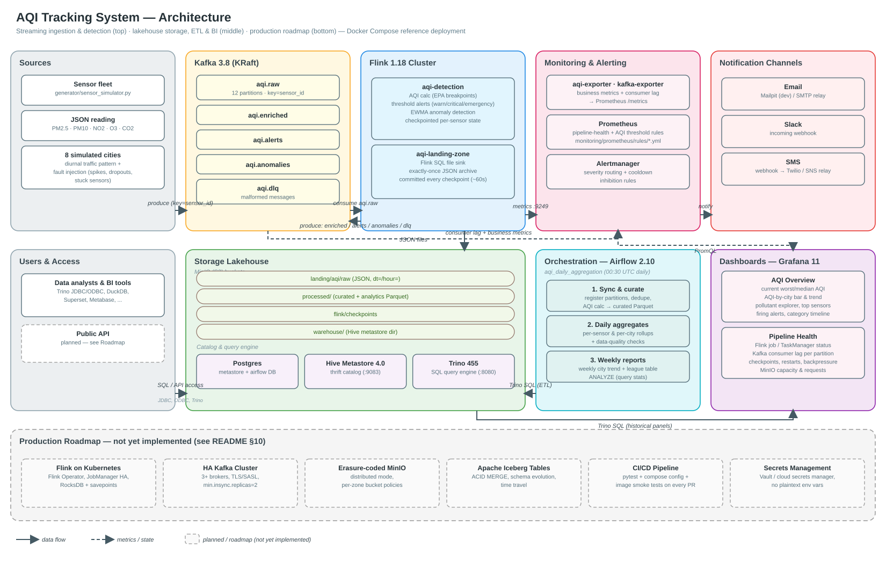

# AQI Tracking System — Project Overview

Companion document to `README.md`, organized around the standard project-overview template.
`README.md` remains the primary setup/reference doc; this file is for onboarding and stakeholder review.
For interview prep and deep technical design discussion, see `docs/SYSTEM_DESIGN.md`.

---

## 1. Start Here

**Project name:** AQI Tracking System

**Problem it solves.** Air quality (PM2.5, PM10, NO2, O3, CO2) changes minute to minute and needs both:
- **immediate visibility** — is a city's air unhealthy *right now*, and who needs to be paged when it is; and
- **durable, queryable history** — what were the daily/weekly trends, which sensors or areas are the worst offenders, for compliance reporting and BI.

Most reference implementations pick one side (a Kafka/Flink real-time demo, or a Spark/Airflow batch demo). This project builds both against the *same* AQI calculation logic, so the live dashboard and the historical reports never disagree about what "AQI 160" means.

**Who it's for.**
- **Data/platform engineers** who need a runnable, open-source reference architecture for an IoT-style ingestion → stream processing → lakehouse → BI pipeline, to adapt to a real sensor fleet.
- **Environmental / public-health teams** who want live AQI dashboards and threshold alerting (email/Slack/SMS) without buying a SaaS platform.
- **Anyone learning the Kafka + Flink + Hive + Trino + Airflow + Prometheus/Grafana stack** — every component here is wired together and actually runs, which is often the hardest part of learning it from docs alone.

---

## 2. Technologies Used

| Category | Choice | Notes |
|---|---|---|
| Languages | Python 3.10–3.12 | Shared AQI logic (3.10-compatible for PyFlink), Flink jobs, Airflow DAGs, exporter, simulator |
| | SQL (Trino dialect) | ETL, curation, aggregation, ad-hoc analytics |
| Streaming | Apache Kafka 3.8 (KRaft, no ZooKeeper) | `aqi.raw/enriched/alerts/anomalies/dlq` topics |
| Stream processing | Apache Flink 1.18 (PyFlink DataStream + Table/SQL APIs) | `aqi-detection`, `aqi-landing-zone` jobs |
| Object storage | MinIO (S3-compatible; `bitnamilegacy/minio` image) | landing / processed / warehouse / flink-checkpoint buckets |
| Catalog | Hive Metastore 4.0 | table/partition metadata, backed by Postgres |
| Query engine | Trino 455 | SQL over Hive-cataloged Parquet/JSON in MinIO |
| Orchestration | Apache Airflow 2.10 (LocalExecutor) | daily curation + aggregation DAG, partition-sync DAG |
| Relational DB | PostgreSQL 16 | Hive Metastore DB + Airflow metadata DB (two logical DBs, one instance) |
| Monitoring | Prometheus 2.54, Alertmanager 0.27, kafka-exporter, custom `aqi-exporter` | pipeline health + AQI business alerts |
| Visualization | Grafana 11 (`trino-datasource` plugin) | 2 provisioned dashboards |
| Local alert sinks | Mailpit (SMTP+web inbox), generic HTTP echo | so email/Slack/SMS routes are testable without real credentials |
| Containerization | Docker Compose v2 | single `docker-compose.yml`, ~20 services, all custom images build from Dockerfiles in-repo |
| Testing | pytest, DuckDB, sqlglot, Jinja2 | unit tests + SQL-vs-Python equivalence checks (see §6) |

No external SaaS dependencies — the entire stack runs on a laptop with Docker Desktop.

---

## 3. Architecture & Flow


*(source: `docs/architecture.py`, regenerate with `python docs/architecture.py`)*

### Entry points

| Component | Entry point |
|---|---|
| Sensor data | `generator/sensor_simulator.py` (Kafka producer; also runnable with `--dry-run` for stdout) |
| Real-time detection | `flink/jobs/aqi_detection_job.py` (`main()`, PyFlink `StreamExecutionEnvironment`) |
| Landing-zone archival | `flink/jobs/landing_zone_job.py` (`main()`, PyFlink Table/SQL API) |
| Metrics bridge | `exporter/aqi_exporter.py` (`main()`, Kafka consumer → `prometheus_client` HTTP server on :8000) |
| Batch ETL | `airflow/dags/aqi_daily_aggregation.py`, `airflow/dags/aqi_landing_partition_sync.py` |
| Shared domain logic | `aqi_common/aqi.py` (AQI math + generated Trino SQL), `aqi_common/detection.py` (parsing, anomaly/alert state machines) |

### Module interactions (data flow)

```
sensor-simulator --(JSON, key=sensor_id)--> Kafka(aqi.raw)
Kafka(aqi.raw) --> Flink(aqi-detection) --> Kafka(aqi.enriched / aqi.alerts / aqi.anomalies / aqi.dlq)
Kafka(aqi.raw) --> Flink(aqi-landing-zone) --(checkpoint-committed JSON)--> MinIO(landing/aqi/raw/dt=/hour=)
Kafka(enriched/alerts/anomalies) --> aqi-exporter --(Prometheus metrics)--> Prometheus --> Grafana / Alertmanager
kafka-exporter --(consumer lag)--> Prometheus
Flink(*) --(:9249 metrics)--> Prometheus
Airflow --(Trino SQL)--> Trino <--(thrift)--> Hive Metastore <--(JDBC)--> Postgres
Trino --(read landing, write curated+analytics Parquet)--> MinIO(processed/)
Grafana --(PromQL)--> Prometheus, --(SQL)--> Trino
Alertmanager --> Mailpit (email) / webhook echo (Slack, SMS relay stub)
```

### APIs / protocols integrated

- **Kafka wire protocol** (producers/consumers), no REST layer for ingestion — keeps the write path low-latency.
- **Thrift** (Trino ↔ Hive Metastore) for catalog metadata.
- **S3 API** (Flink S3A filesystem, Trino native-S3, `mc`) against MinIO for all object storage.
- **PromQL** and **Prometheus remote-scrape HTTP** (`/metrics` endpoints) for all monitoring.
- **Trino client protocol** (HTTP+JSON) used by Airflow's Trino provider and Grafana's Trino datasource plugin.
- **Alertmanager webhook API** — used generically so a real SMS gateway (Twilio/SNS/etc.) can be plugged in by URL alone.

### Frontend ↔ backend ↔ DB

There is no traditional frontend/backend web app here — Grafana *is* the frontend, querying two backends directly (Prometheus for live metrics, Trino for historical SQL), and Airflow's UI is the batch-pipeline operator console. This keeps the system to "engines and glue," not a bespoke API layer, which fits an internal data-platform tool.

---

## 4. Core Functionality

### 4.1 Ingestion (`generator/`, `kafka/`)
- `sensor_simulator.py` models a fleet of sensors across 8 cities with realistic diurnal traffic patterns, occasional multi-minute "pollution episodes," and injected sensor faults (spikes, negatives, dropouts, stuck values) — this is what lets the anomaly detector and alerting actually be exercised end-to-end.
- `kafka/create-topics.sh` provisions 5 topics with partition counts and retention tuned per purpose (12 partitions for high-volume raw data keyed by sensor, 3 for low-volume alerts/anomalies/DLQ with long retention for audit).

### 4.2 Real-time processing (`flink/jobs/aqi_detection_job.py`)
Business logic, step by step, per reading:
1. **Parse & validate** (`aqi_common.detection.parse_reading`) — malformed JSON/missing fields/bad timestamps are routed to `aqi.dlq` instead of crashing the pipeline.
2. **Compute AQI** (`aqi_common.aqi.compute_aqi`) using the 2024 EPA breakpoint tables for PM2.5/PM10/NO2/O3, taking the max sub-index and recording the dominant pollutant; CO2 gets a separate indoor-air-quality level.
3. **Per-sensor keyed state** (Flink `KeyedProcessFunction`, checkpointed to MinIO):
   - **`ThresholdAlerter`** — severity escalates (warning→critical→emergency) as AQI/CO2 cross fixed EPA-aligned limits; re-fires after a cooldown window (event-time based, so backfills don't spam); emits `RESOLVED` on recovery.
   - **`AnomalyDetector`** — EWMA mean/variance per pollutant per sensor; flags z-score spikes/drops, physically impossible values, and "stuck" sensors repeating the same value.
4. **Fan-out** — every reading (with AQI attached) goes to `aqi.enriched`; alerts/anomalies go to their own topics.

### 4.3 Landing-zone archival (`flink/jobs/landing_zone_job.py`)
A separate, independently-scalable Flink SQL job that just archives every raw reading to MinIO as partitioned JSON (`dt=/hour=`), with exactly-once file commits tied to Flink checkpoints. Decoupled from detection so a bug/restart in one job never blocks the other.

### 4.4 Batch ETL (`airflow/dags/`)
- **`aqi_daily_aggregation`** (business logic, UI: Airflow → DAGs): sync partitions → wait for data → **curate** (dedupe, drop implausible values, compute AQI *again* — but via generated Trino SQL, see §6 — write Parquet) → **data-quality check** (SQLCheckOperator: row counts, duplicate keys, null-AQI ratio, timestamp bounds) → **aggregate** daily-per-sensor, daily-per-city, weekly-per-city → `ANALYZE` for query planner stats. Every step overwrites its partition, so reruns/backfills are idempotent.
- **`aqi_landing_partition_sync`**: every 15 minutes, registers newly-written landing partitions so ad-hoc SQL sees near-real-time raw data without waiting for the nightly DAG.

### 4.5 Serving & monitoring
- **`exporter/aqi_exporter.py`** bridges Kafka business events into Prometheus gauges/counters (latest AQI per sensor, active alerts, anomaly rates) — this is the business-logic layer that turns "topics" into "dashboards and alert rules."
- **Prometheus rules** (`monitoring/prometheus/rules/*.yml`) split cleanly into *pipeline health* (Kafka lag, Flink job state, checkpoint failures, DLQ growth) and *AQI business alerts* (unhealthy/hazardous thresholds, sensor silence, anomaly bursts) — different audiences, different routes.
- **Alertmanager** routes by label (`category`, `severity`, `team`) to email/Slack/SMS, with inhibition rules so a "Hazardous" alert suppresses the redundant lower-severity ones for the same city.
- **Grafana** — UI-only layer; two dashboards (`AQI Overview`, `AQI Pipeline Health`) generated from `grafana/dashboard-gen` type script (see `docs/architecture.py` sibling pattern) sourcing Prometheus (live) and Trino (historical).

---

## 5. Setup & Execution

Full detail lives in `README.md`; summary:

```bash
cp .env.example .env                 # optional, has working local defaults
docker compose up -d --build         # builds 5 custom images, starts ~20 services
```

- **Configuration files:** `.env` (all tunables — credentials, retention, simulator rate, alert routing); `flink/Dockerfile` + inline `FLINK_PROPERTIES` in `docker-compose.yml`; `trino/catalog/hive.properties`; `hive/conf/hive-site.xml`; `monitoring/prometheus/prometheus.yml` + `rules/*.yml`; `monitoring/alertmanager/alertmanager.tmpl.yml` (env-substituted at container start by `entrypoint.sh`).
- **Build/run commands:** `docker compose build`, `docker compose up -d`, `docker compose ps`, `docker compose logs -f <service>`.
- **"Deployment pipeline":** this repo ships a *local reference deployment* (Docker Compose), not a CI/CD pipeline to a hosted environment — see §8 for the production-hardening path (Kubernetes, HA Kafka/Postgres, secrets management).
- **Verified startup order** (documented and observed live): `postgres, kafka, minio` → `kafka-init, minio-init` → `jobmanager, taskmanager` → `flink-job-submitter` → `hive-metastore` → `trino` → `trino-init` → `airflow-*`.

---

## 6. Testing & Validation

Unit/integration tests (`tests/`, run with `python -m pytest tests -q`, currently **53 passing**):

| File | Validates |
|---|---|
| `tests/test_aqi.py` | EPA AQI breakpoint math (truncation, boundaries, category mapping), and — critically — that the **generated Trino SQL produces bit-identical results to the Python implementation** by executing the SQL in DuckDB and diffing against `aqi_common.aqi.sub_index()` for thousands of random values per pollutant. This is what guarantees the real-time (Flink/Python) and batch (Airflow/Trino SQL) AQI never drift apart. |
| `tests/test_detection.py` | Reading parsing/validation (malformed → `MalformedReading`), the `AnomalyDetector` state machine (warm-up, spike/drop detection, stuck-sensor detection, out-of-range handling not polluting the baseline), and the `ThresholdAlerter` state machine (escalation, cooldown, resolution, JSON-serializability of state for Flink checkpointing). |
| `tests/test_sql_templates.py` | Every Jinja2-templated Airflow SQL file (`airflow/dags/sql/*.sql`) renders to **valid, parseable Trino SQL** (via `sqlglot`), and that the `target_date` parameter overrides correctly. Also validates `trino/sql/ddl.sql` parses as 9 well-formed statements. |

**End-to-end validation performed during initial bring-up** (see conversation history / operational log):
- Confirmed both Flink jobs reach `RUNNING` with all tasks deployed.
- Confirmed `aqi.enriched` messages produce correct `aqi_index` values in the exporter's `/metrics`.
- Confirmed landing-zone files land in MinIO on each checkpoint and are queryable via Trino immediately after `sync_partition_metadata`.
- Ran a 48-hour backfill (11,520 messages) and a full `aqi_daily_aggregation` DAG run to completion (all 8 tasks green), producing correct curated (5,760 rows) and city-level aggregates (e.g., Delhi: avg AQI 193, 94.7% unhealthy readings, matching the simulated pollution episode).
- Confirmed Prometheus alert rules fire correctly (`AQIHazardous`, `AQIVeryUnhealthy` on the simulated Delhi episode) and Alertmanager delivered the email to Mailpit.
- Confirmed Grafana has both dashboards provisioned against all 3 datasources.

**Debugging/logging setup:**
- `docker compose logs -f <service>` is the primary debugging tool; Flink additionally exposes its UI (job graphs, exception stack traces, checkpoint history) at `:8081`.
- Two real bugs were caught and fixed this way during bring-up (documented in `README.md`'s troubleshooting section): a PyFlink packaging issue (`aqi_common` shipped as a directory instead of a zip, causing `ModuleNotFoundError` on the worker) and a Hive Metastore 4 / Trino incompatibility with timestamp column statistics (`ANALYZE` on the curated table).
- No CI/CD pipeline is currently configured for this repo (see §8).

---

## 7. Purpose & Outcomes

**What success looks like:**
- A city's AQI crossing into "Unhealthy" is visible on a dashboard and in an inbox/Slack channel within minutes, not next-day.
- A year of historical AQI data is queryable with plain SQL in under a second (Trino + partitioned Parquet), supporting compliance reports and trend analysis without re-processing raw data.
- The same AQI number is reported whether you're looking at the live dashboard or a historical report — no reconciliation discrepancies between "the real-time system" and "the data warehouse," which is a common failure mode in dual-pipeline architectures.

**Expected deliverables (all present in this repo):**
- Live AQI dashboard + pipeline health dashboard (Grafana)
- Threshold/anomaly alerting via email, Slack, SMS-webhook (Alertmanager)
- Queryable SQL warehouse of raw, curated, and aggregated AQI data (Trino/Hive/MinIO)
- Daily/weekly aggregation reports (`hive.analytics.*` tables, `v_city_daily_trend` view)
- A reference Docker Compose deployment anyone can run locally to evaluate or extend

**Stakeholder benefit:**
- **Public-health / operations teams** get actionable, low-latency alerts instead of manually checking dashboards.
- **Data engineers** get a proven integration pattern (Kafka→Flink→Lakehouse→Trino→Airflow) they can point real sensor hardware at, instead of building the plumbing from scratch.
- **Decision-makers / BI users** get a standard SQL interface to historical air-quality trends, compatible with any BI tool that speaks Trino/Presto.

---

## 8. Improvements & Next Steps *(Recommended)*

**Correctness / robustness**
- Add a schema registry (Avro/Protobuf) for the sensor payload contract instead of loose JSON — catches producer/consumer drift at write time rather than in the DLQ.
- Extend `ThresholdAlerter`/`AnomalyDetector` state to survive sensor state TTL expiry more gracefully (currently a silent sensor's state is dropped after 7 days, which is a reasonable default but worth making configurable per deployment).
- Add contract tests between `aqi_common.detection` (Python) and the Flink job wiring itself (currently only the pure functions are unit-tested; the PyFlink `ProcessFunction`/`KeyedProcessFunction` glue is exercised only by the live end-to-end run, not an automated integration test).

**Performance / scale**
- Move Flink state backend from HashMap to RocksDB with incremental checkpoints before scaling past a handful of TaskManagers.
- Increase `aqi.raw` partitions and `DETECTION_PARALLELISM` together as sensor count grows (currently 12 partitions / parallelism 2, documented scaling path in README).
- Consider Apache Iceberg (via Trino's `iceberg` connector on the same Hive Metastore) instead of plain Hive tables — gets ACID `MERGE`, schema evolution, and time travel for the curated zone with minimal migration effort, since the metastore is already in place.

**Operational maturity**
- No CI/CD pipeline is configured yet — add one (e.g., GitHub Actions) to run `pytest`, `docker compose config --quiet`, and a build-and-smoke-test of the custom images on every PR.
- Move from the single-node Compose stack to Kubernetes for anything beyond local dev/demo: Flink Kubernetes Operator, MinIO distributed/erasure-coded mode, HA Postgres, Trino worker autoscaling (all outlined in `README.md`'s "Taking this to production" section).
- Replace environment-variable secrets with a real secrets backend (Vault, AWS Secrets Manager, or Docker/Kubernetes secrets) before any non-local deployment.

**Feature ideas**
- A public-facing read-only API (thin FastAPI/Flask layer over Trino) so external consumers don't need direct SQL access.
- Geospatial interpolation between sensors (e.g., a simple IDW/kriging layer) to show an AQI heatmap rather than only point readings.
- Per-user/subscription alerting (e.g., "notify me if AQI near my location exceeds X") built on top of the existing `aqi.alerts` topic, which is already decoupled from Prometheus/Alertmanager for exactly this kind of downstream fan-out.
